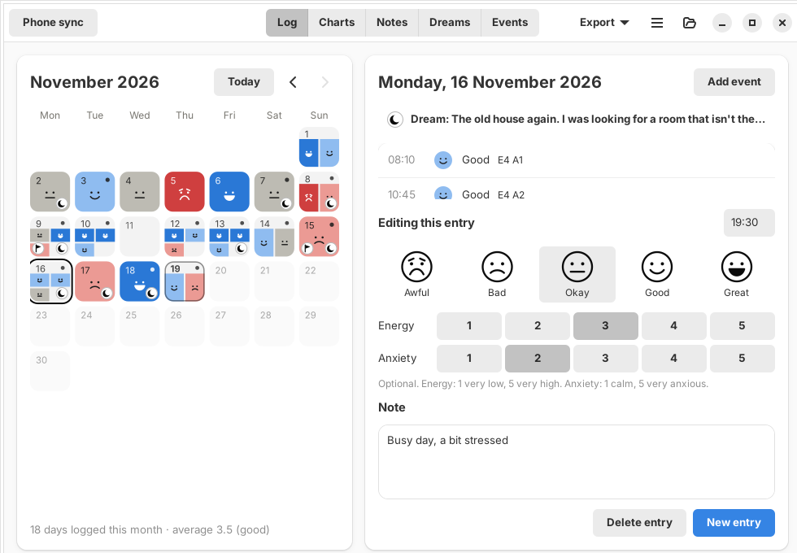
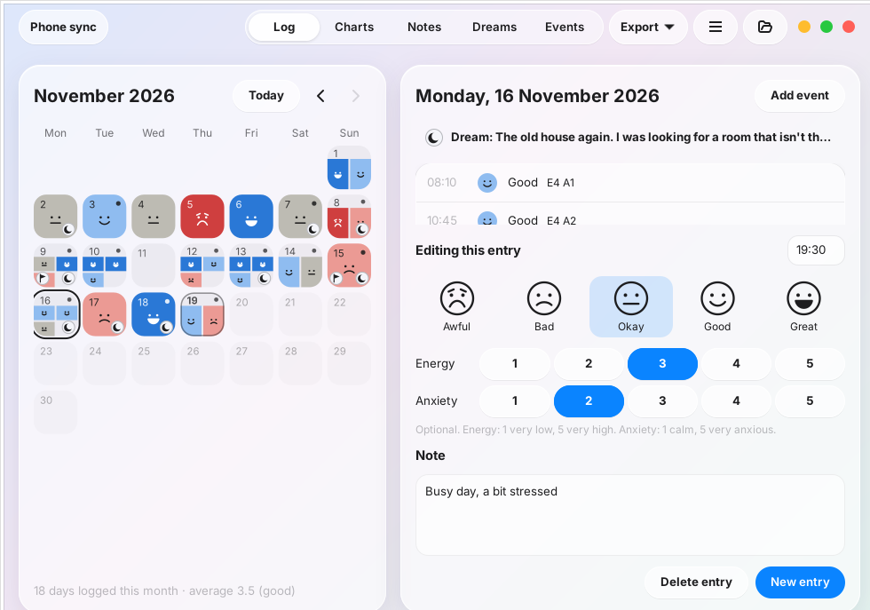

# Moodlog

A small, local mood tracker for Linux (GTK 4 / libadwaita, one Python file).

- **Log**: pick one of five moods, optionally rate your energy and anxiety (1-5), and add a note. A day can hold several entries, each with its own time, so you can record how your mood changes through the day. Click any past day in the month calendar to add or edit entries.
- **Charts**: per month, per year or all time: average, days logged, most common mood, streak, mood over time, how often each mood, average by weekday and by time of day, mood next to your health data, and energy and anxiety over time.
- **Notes**: every note, newest first, with search. Click one to jump to that day.
- **Events**: log important events, such as a medication change. They show as a flag on the calendar day and as a dashed line on the charts, and each one shows your average mood in the two weeks before and after it.

## Screenshots

These are screenshots of the real app. The PC ones use made-up sample data.

**Log**: the month calendar (days with several moods show one tile per entry, flags
mark events) and the editor for the selected day.

**Charts** (dark mode): mood day by day with events marked, sleep from the phone,
energy and anxiety, and more below.

**Events**: each event with your mood in the two weeks before and after it.

**Tahoe style** (☰ menu → Tahoe), in light and dark.

**Moodlog for iPhone**: the month calendar on the phone, synced with the PC.

**Report for your doctor**: the first page of the PDF.

## Phone sync (Apple Health)

Moodlog can receive daily steps, sleep and heart rate from an iPhone, so you can
compare them with your mood on the Charts tab.

Apple Health has no API a PC can read, so the phone sends the data: an iPhone
Shortcut posts the last 7 days to a small receiver on this PC over your home
Wi-Fi. Open **Phone sync** in the title bar, switch the receiver on, and follow
the iPhone steps shown there (address and token included).

- The receiver is `moodlog --sync-server`, run as the systemd user service
  `moodlog-sync.service`, listening on port 8765.
- It only accepts `POST /health` requests that carry your token, and never
  sends data out. Traffic is plain HTTP, so use it on a network you trust.
- Values are stored in `~/.local/share/moodlog/health.csv` (`date,metric,value`).
- Accepted formats: text lines `metric;date;value` (and `sleep;start;end;stage`),
  JSON `{"data": "<those lines>"}`, JSON `{"date": ..., "steps": ..., ...}`,
  and the Health Auto Export app's REST format (that one is untested).

Events are kept in `events.csv` in the same folder (columns: `date,kind,title,note`).

## Export

The **Export** menu in the title bar saves everything to a file:

- **Spreadsheet (.xlsx)**, with colours and charts: a Summary sheet (key figures,
  how often you logged each mood, average mood by month), a Days sheet (one row
  per day with coloured moods, notes, events and health numbers), an Entries
  sheet (every single mood with its time) and an Events sheet (with your mood in
  the two weeks before and after each one).
- **Plain CSV (.csv)**: the same day-by-day table as text, without formatting.

Both open in LibreOffice Calc, Excel or Google Sheets. From a terminal:
`moodlog --export FILE.xlsx` or `moodlog --export FILE.csv`.

## Gridgets widget link

If you use the [Gridgets](https://github.com/rebatnaath/gridgets) GNOME Shell
extension, Moodlog links itself to its mood widget (same 1-5 scale):

- a mood picked in the desktop widget is logged in Moodlog as a new entry with
  the time you picked it, within a few
  seconds if Moodlog is open, otherwise the next time you open it;
- moods logged or changed in Moodlog are written to the widget's files in
  `~/.local/share/gridgets/mood/`. Gridgets reads those when it starts, so the
  widget shows them after the next unlock or login.

The widget holds one mood per day, so Moodlog gives it the day's latest entry.
Moodlog's CSV stays the source of truth. The link only runs while Moodlog is
open and can be switched off at the bottom of the Log tab. Gridgets itself is
not modified.

### Moodlog for iPhone

There is also a native iPhone app (in `ios/`): log moods, energy, anxiety, notes
and events on your phone, and they sync with Moodlog on your PC through the same
receiver (newest change wins; deletions sync too). It can send Apple Health data
as well, so it can replace the shortcut. Every [release](https://github.com/Akii-G/moodlog/releases)
includes it as `Moodlog-iPhone-<version>.ipa`. See [`ios/README.md`](ios/README.md) for
how to install it (SideStore or AltStore) and connect it.

### iPhone shortcut

A ready-made shortcut is available here:
**[Get "Moodlog Sync" for Shortcuts](https://www.icloud.com/shortcuts/db962227cb6547b4b480a1060afb0b9f)**

It sends the last 7 days of steps, resting heart rate and sleep to Moodlog.

1. In Moodlog, open **Phone sync** and switch the receiver on. Keep that window
   open for the address and token.
2. Open the link above on your iPhone and tap **Get Shortcut**. Shortcuts asks two
   questions:
   - **Address**: the address shown in Phone sync, for example
     `http://your-pc.local:8765/health`.
   - **Header**: tap **Add new header**, enter `Authorization` as the key and
     `Bearer ` followed by your token as the value.
3. Run the shortcut once and allow access to Health. If iOS says the shortcut is
   not allowed to share that many Health items, turn on **Allow Sharing Large
   Amounts of Data** in Settings → Apps → Shortcuts → Advanced, then run it again.
4. To sync every day: Shortcuts → **Automation** → **+** → **Time of Day**, pick a
   time when you usually use your phone (Health data can't be read while the
   iPhone is locked), choose **Run Immediately** and select the shortcut.

The iPhone and the PC must be on the same Wi-Fi, and the PC must be on when the
shortcut runs. Days that were missed are filled in on the next run.

## Styles

The menu button (☰) in the title bar switches between two styles, and Moodlog
remembers your choice:

- **Default (GNOME)**: the standard libadwaita look, matching other GNOME apps.
- **Tahoe (macOS-like)**: frosted, translucent cards on a soft colour wash, pill
  buttons and tabs, macOS blue, rounder corners and red/yellow/green window
  buttons. GTK cannot blur what is behind a window, so the glass effect is drawn
  inside the app. Both follow your light or dark setting.

## Dream journal

The **Dreams** tab (on the PC and on the iPhone) is a dream journal. Each dream
belongs to the morning you woke up. Write what you remember, pick how it felt
(pleasant, neutral or disturbing) and tick tags such as nightmare, vivid,
recurring or lucid; on a night you can't remember, tick "Didn't remember", which
counts too. Nights with a dream show a moon in the calendar. The tab and Charts
show how many nights had a dream or a nightmare and, once there is enough data,
your mood on days after a disturbing dream compared with other days. Dreams sync
between the iPhone and the PC like moods, and are kept in `dreams.csv`
(`date,feeling,tags,text,id,updated,deleted`).

Dreams are private: the doctor report leaves them out unless you tick "Include
dreams" (how many, and the nightmare nights marked in the day-by-day table), and
"Also what the dreams were about" adds the text.

## Report for your doctor

**Export → Report for your doctor (.pdf)** makes a printable A4 report for a period
you choose (last 30 days, 3 or 6 months, this year, everything, or your own dates):
key numbers, how often each mood was logged, your mood over time with your events
(such as medication changes) marked and numbered, energy and anxiety, sleep, a
table of the events with your mood in the two weeks before and after each one,
and a day-by-day table. Notes and dreams are left out unless you tick "Include my
notes" or "Include dreams". From a terminal:
`moodlog --report FILE.pdf --from 2026-09-01 --to 2026-11-30` (add `--notes`,
`--dreams` or `--dream-text`).

## Backup, restore and two computers

The folder button in the title bar has **Back up…** (one .zip file with all your
data) and **Restore from a backup…**. Restoring always saves a copy of your current
data first, in `backups/` inside your data folder.

**Data folder and sync…** lets you keep your data in another folder, for example
one that Syncthing or Nextcloud keeps in sync, so you can use Moodlog on two
computers. Choose the folder on both. When the second computer already has data of
its own, choose **Merge** to combine both. Moodlog picks up changes from the other
computer within a few seconds. If both change something at the same moment and the
sync app makes a conflict copy, Moodlog shows a bar at the top to merge it, so
nothing is lost. Settings such as the Gridgets link stay on each computer
(`~/.config/moodlog/`).

## Your data

Your moods are in a plain CSV file, `~/.local/share/moodlog/moods.csv` (or in the folder you chose)
(columns: `date,time,mood,energy,anxiety,note,id,updated,deleted`; one row per entry, time is `HH:MM` or empty, mood is 1 = awful to 5 = great, energy and anxiety are 1-5 or empty). In the calendar, a day with one entry is coloured by that mood, and a day with several shows a small grid with one tile per entry, in time order. A day's point in the charts is the average of its entries. Nothing leaves your
computer. The folder button in the title bar opens that folder and makes backups.

## Languages

Moodlog is in English and Italian, on the PC and on the iPhone. It follows your
system language. On the PC you can also choose one in the ☰ menu → **Language**; on the
iPhone, in Settings → Moodlog → Language. Dates, charts, the doctor report and exports
follow the chosen language; your notes and the data files stay as they are.

To add a language: copy `po/moodlog.pot` to `po/<code>.po` and fill in the `msgstr`
lines (any gettext editor such as Poedit works), add the code to `LANGUAGES` in
`src/moodlog`, and for the iPhone copy `ios/Moodlog/it.lproj` to `<code>.lproj`.
`tools/extract_strings.py --check` and `tools/extract_ios_strings.py --check` list
anything still missing.

## What's new

After each update Moodlog shows what changed, once. You can open the full list again from the ☰ menu → **What's new**, or read [CHANGELOG.md](CHANGELOG.md).

## Install

    sudo apt install ./moodlog_2.3.1_all.deb

Remove with `sudo apt remove moodlog` (your CSV is kept).

## Run from source

    sudo apt install python3-gi python3-gi-cairo gir1.2-gtk-4.0 gir1.2-adw-1 python3-openpyxl
    ./src/moodlog

## Build the .deb

    ./build-deb.sh

## Licence

MIT

## Tests

The scripts in `test/` check the storage, the phone-sync parser, events and the
Gridgets link, and the translations (`python3 test/test_store.py`, `test/test_i18n.py` and so on). The `ui*.py` and
`interact.py` scripts drive the real window and need a display (or `xvfb-run`).

## Roadmap

Moodlog is for people who track their mood for their health and want to keep that data
private. Next: making it solid for them (languages, a first-run welcome, a privacy
policy, accessibility), then Flathub for every Linux distro, then the iPhone and Mac
App Stores, then Windows. See [ROADMAP.md](ROADMAP.md) for the details.
