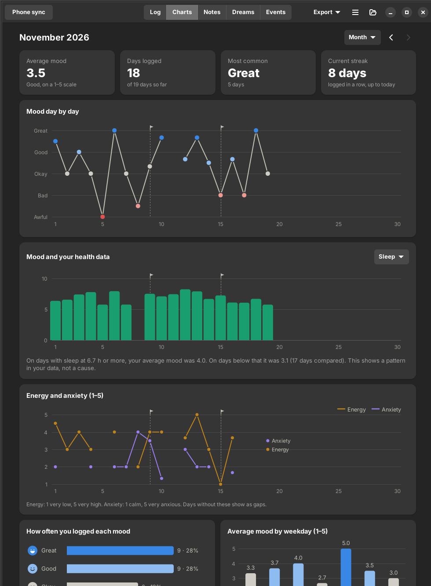
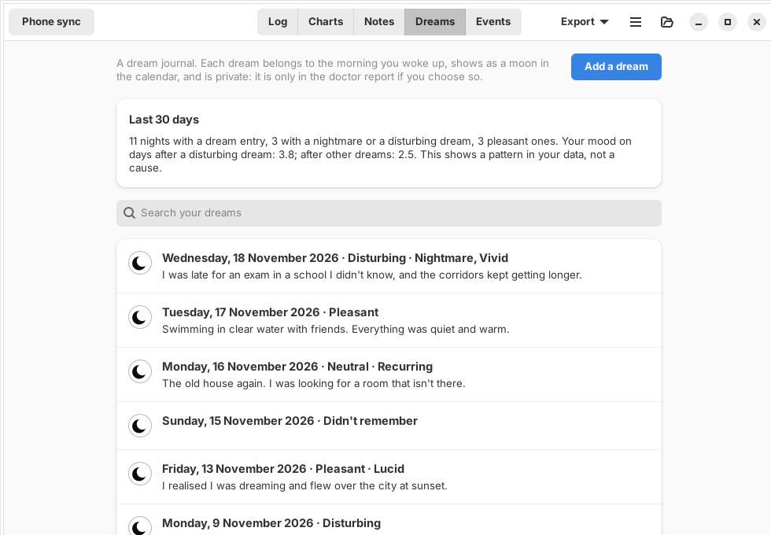
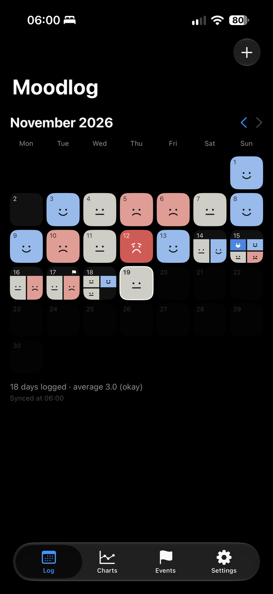
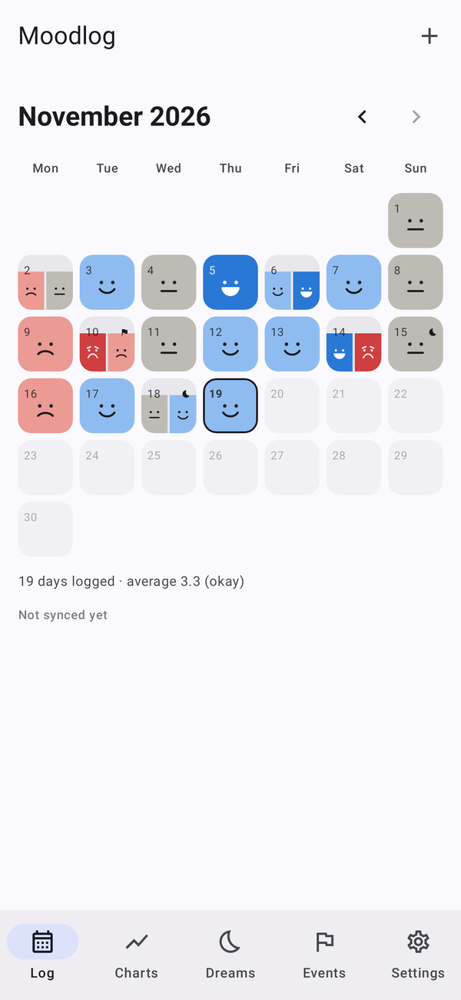
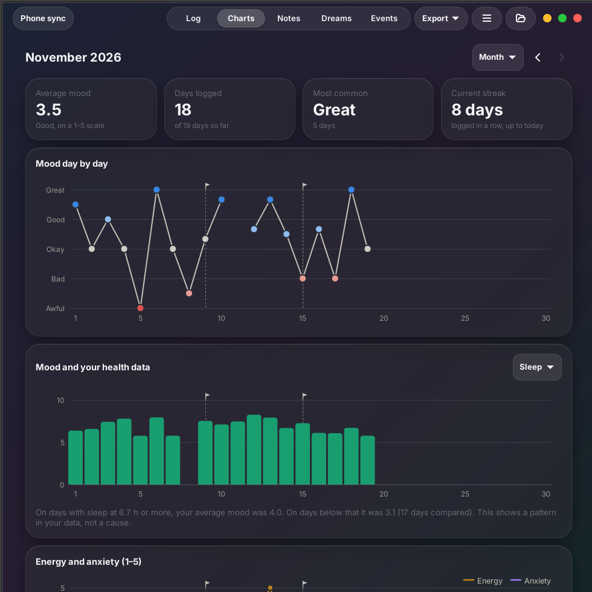

# Sottovoce — a quiet mood diary

*Formerly called Moodlog. Same app, new name: your data and sync carry on as before.*

> **New: [Dose](https://github.com/Akii-G/dose-tracker)**, Sottovoce's sister app for your
> medicines. It reminds you when a dose is due and remembers what you took, on Linux, Windows,
> iPhone and Android. Sottovoce reads it on the PC, so your doses show up in the doctor report.

> **The Windows version is in beta.** It's new and hasn't been used much yet, so
> something may not work as it should. If you find a problem, please
> [open an issue](https://github.com/Akii-G/sottovoce/issues).

A small, private mood diary for Linux and Windows, with companion apps for iPhone and Android. Log how
you feel in one click, see how things go over weeks and months, mark events such as
a medication change, keep a dream journal, and bring a clear PDF report to your
doctor. No account and no cloud: everything stays in plain files on your devices.

In English and Italian. A short welcome tour explains everything the first time
you open it.

*Screenshots of the real app with made-up sample data.*

## Contents

- [What you can do](#what-you-can-do)
  - [Log your mood](#log-your-mood)
  - [See how things go](#see-how-things-go)
  - [Mark what matters](#mark-what-matters)
  - [Keep a dream journal](#keep-a-dream-journal)
  - [Bring a report to your doctor](#bring-a-report-to-your-doctor)
  - [Questionnaires for your doctor](#questionnaires-for-your-doctor)
  - [A gentle reminder, and a kind word](#a-gentle-reminder-and-a-kind-word)
  - [Make it yours](#make-it-yours)
  - [Use it on your iPhone too](#use-it-on-your-iphone-too)
  - [Or on your Android phone](#or-on-your-android-phone)
  - [Change the look](#change-the-look)
- [Install](#install)
- [Your data](#your-data)
- [For developers](#for-developers)
- [A word from the developer](#a-word-from-the-developer)
- [Licence](#licence)

## What you can do

### Log your mood

Pick one of five faces, from Awful to Great. That's the whole job. Energy, anxiety
(1–5) and a note are optional. A day can hold several entries, each with its own
time, and you can fill in any past day from the calendar. Each day takes the
colour of its mood; a day with several shows one small tile per entry.

If five faces aren't enough, add **feeling words** like Joy, Tiredness or Worry, and
**activities** for what you did, like Work, Walk or Friends, to see later what helps. And
when you don't know what to write, an empty note shows a gentle **question**, a
different one each day. All optional, and each can be turned off in Customize.

The **Notes** tab lists every note, newest first. Its search also finds feeling words,
activities and events, and doesn't mind capitals or accents. On the phones, it's the magnifying glass
next to + in the diary.

**Before the appointment**: in Events, set the date of your next appointment with your
doctor or therapist. In the week before, the Log shows a calm recap since the last one,
and you can keep a list of things you want to talk about; tick them once said. The rest
can go in the report, if you choose.

**Your week, gently**: on Sunday evening and on Monday, a few calm words about your week:
days logged, the usual mood, your best day. No scores.

### See how things go

The **Charts** tab works per month, per year or for all time: average mood, days
logged, most common mood, your streak, mood day by day, how often each mood,
average by weekday and by time of day, energy and anxiety, and your mood next to
sleep and steps from your iPhone.

### Mark what matters

Log events such as a medication change or something big that happened. They show
as a flag in the calendar and a dashed line in the charts, and each one shows your
average mood in the two weeks before and after it.

### Keep a dream journal

The **Dreams** tab is a dream journal. Each dream belongs to the morning you woke
up: write what you remember, pick how it felt and tick tags such as nightmare,
vivid, recurring or lucid ("Didn't remember" counts too). Nights with a dream show
a moon in the calendar, and once there is enough data Sottovoce compares your mood
on days after a disturbing dream with other days. Dreams are private: the doctor
report leaves them out unless you ask.

### Bring a report to your doctor

**Export → Report for your doctor (.pdf)** makes a printable A4 report for the
period you choose (the last 7 days, 2 weeks, 30 days, 3 or 6 months, this year,
everything, or your own dates): key numbers, your mood over time with your events marked, energy
and anxiety, sleep, your mood around each event, and a day-by-day table. Notes and
dreams are left out unless you tick them.

Two fixes in the report window, on the PC and on both phones, synced between them:

- **Short nights**: nights under 4 hours are listed so you can delete the ones when your watch
  was charging. They go away from Sottovoce everywhere, and Apple Health or Health Connect
  won't bring them back with the next sync. Real short nights are worth keeping: they matter
  to your doctor.
- **Medicine names**: if you logged a medicine in Apple Health and then in Dose under another
  name (*Aripiprazolo 10mg* and *Aripiprazolo Teva 15 mg*), give it one name and all its doses
  show under it. Sottovoce suggests the names that look alike (also by Dose's active
  ingredient), and a dose marked in both apps on the same day counts once.

The phone apps make exactly the same report (the document button in **Charts**), to
share, print or save straight from the phone.

### Your diary as a book

**Export → Your diary as a book (.pdf)** lays out your notes month by month, each day
with its mood faces, feeling words, activities and events, as a PDF to keep or print.
Private moments stay out unless you choose to include them. On the phones it's in
**Charts** too.

The **Export** menu also saves everything as a spreadsheet (.xlsx, with colours and
charts) or a plain CSV file, which open in LibreOffice Calc, Excel or Google Sheets.

### Dose, the sister app for your medicines

[Dose](https://github.com/Akii-G/dose-tracker) keeps your medicines and reminds you when it's
time. When it's on the same PC, Sottovoce reads it: the day shows what you took, the doctor
report counts each medicine's doses taken, skipped, not taken and still to take (medicines you
no longer take go under **Previous medication**), and starting, changing or stopping a medicine
adds a Medication change event, so you see your mood before and after. The phones get it with
the sync.

### Questionnaires for your doctor

Two short questionnaires doctors use, with their official words in English and
Italian: **PHQ-9** about low mood and **GAD-7** about anxiety (☰ → **Questionnaires for
your doctor** on the PC, **Settings → Questionnaires** on the phones). Sottovoce shows
only your score and a chart of scores over time, never a label or a diagnosis. The
report for your doctor can include them, with each answer, and they sync between your
devices. Two weeks after the last one, Sottovoce asks gently if you'd like to answer
again: a card on the PC, a notification on the phone.

PHQ-9 and GAD-7 were developed by Drs. Robert L. Spitzer, Janet B.W. Williams, Kurt
Kroenke and colleagues, with an educational grant from Pfizer Inc. No permission is
required to reproduce, translate, display or distribute them.

### A gentle reminder, and a kind word

If you like, Sottovoce reminds you once a day at the time you choose, only on days you
haven't logged a mood yet: a quiet notification on the PC (☰ → **Customize your
experience**) or the phone (**Settings → Reminder**). No streaks, no guilt.

After a few very hard days close together, the Log shows a short, kind note with a
helpline (Telefono Amico in Italian, Find A Helpline in English). It never tells
anyone, and you can hide it or turn it off.

### Make it yours

**Customize your experience** (in the tour, ☰ on the PC, **Settings** on the phones)
turns off what you don't need: Dreams, or Medication on the PC and iPhone. Nothing is
deleted, it's only hidden. You also choose how days with several moods look on the
calendar: all of them in a small grid, or only the latest one with a "×3".

Any note or dream can be ticked **Private**: a private note never goes in the report
for your doctor, and a private dream is only counted there, never shown. In Customize
you can hide the tick, or have every new note and dream start private.

### Use it on your iPhone too

**Sottovoce for iPhone** logs moods, energy, anxiety, notes, events and dreams on
your phone, and syncs them with Sottovoce on your PC over your home Wi-Fi, even if
you logged while away. It can also send sleep, steps and resting heart rate from
Apple Health. Every [release](https://github.com/Akii-G/sottovoce/releases) includes
it as `Sottovoce-iPhone-<version>.ipa`; see [`ios/README.md`](ios/README.md) to install
it with SideStore or AltStore.

To connect it, open **Phone sync** on the PC, switch the receiver on, and enter the
address and token shown there in the iPhone app's Settings.

On iOS 26 or newer, Sottovoce for iPhone can also read the medications you log in the
Health app (**Settings → Medication**): each day shows the doses you took or skipped,
the report for your doctor gets a Medication section, and your PC receives them with
the health data. Sottovoce only reads them and never changes anything in Health.

On both phones, **Charts** also shows your sleep night by night next to your mood,
and **Settings → Backup** keeps a copy of everything in iCloud Drive or Google Drive
(or any folder you pick), so the phone app works on its own, without a PC. A backup
from one phone restores on the other.

### Or on your Android phone

**Sottovoce for Android** does the same: moods, energy, anxiety, notes, events and
dreams, synced with your PC over Wi-Fi, encrypted. It can send sleep, steps and
resting heart rate from Health Connect, which most watches and fitness apps share
with. Every [release](https://github.com/Akii-G/sottovoce/releases) includes it as
`Sottovoce-Android-<version>.apk`: open it on your phone to install it (see
[`android/README.md`](android/README.md)).

Connect it the same way: **Phone sync** on the PC, then the address and token in the
app's Settings.

Prefer a Shortcut for Apple Health instead of the app?

A ready-made shortcut sends the last 7 days of steps, resting heart rate and sleep:
**[Get "Sottovoce Sync" for Shortcuts](https://www.icloud.com/shortcuts/db962227cb6547b4b480a1060afb0b9f)**

1. In Sottovoce, open **Phone sync** and switch the receiver on. Keep that window
   open for the address and token.
2. Open the link on your iPhone and tap **Get Shortcut**. For **Address** enter the
   address shown in Phone sync (for example `http://your-pc.local:8765/health`); for
   **Header**, add `Authorization` with the value `Bearer ` followed by your token.
3. Run it once and allow access to Health. If iOS says it can't share that many
   Health items, turn on **Allow Sharing Large Amounts of Data** in Settings → Apps →
   Shortcuts → Advanced.
4. To sync every day: Shortcuts → **Automation** → **+** → **Time of Day**, pick a time
   when you usually use your phone, choose **Run Immediately** and select the shortcut.

The iPhone and the PC must be on the same Wi-Fi and the PC must be on. Missed days
are filled in on the next run.

### Change the look

The ☰ menu switches between two styles, **Default** (GNOME) and **Tahoe**
(macOS-like, with frosted cards and pill buttons), both in light and dark. It also
has the language (English, Italian, or your system's), what's new after each update,
and the welcome tour.

The tour dims the window except for the part it explains, and walks through
everything in a few calm steps. The phone apps have their own, which switches to
each tab as it goes.

## Install

Download `sottovoce_<version>_all.deb` from the
[latest release](https://github.com/Akii-G/sottovoce/releases/latest), then:

    sudo apt install ./sottovoce_3.3.0_all.deb

Remove it with `sudo apt remove sottovoce`; your data is kept.

**On Windows 11 or 10** (beta), download `Sottovoce-Setup-<version>.exe` from the same release
and open it. Windows may warn that the app is from an unknown publisher, because the
installer isn't signed: choose *More info → Run anyway*. It's the same app, phone sync
included; your data is in `%LOCALAPPDATA%\Moodlog`, and it stays there if you uninstall. For the phone apps, see
[`ios/README.md`](ios/README.md) and [`android/README.md`](android/README.md).

## Your data

Everything is in plain CSV files in `~/.local/share/moodlog/`, or in a folder you
choose: `moods.csv`, `events.csv`, `dreams.csv` and `health.csv`. Nothing leaves your
devices, there is no account, and the phone only talks to your own PC, encrypted.
The [privacy policy](PRIVACY.md) ([in italiano](PRIVACY.it.md)) says exactly what is
stored and sent; in the app it's under ☰ → Privacy.

- **Back up and restore**: the folder button in the title bar makes one .zip with
  all your data and restores it (your current data is saved first).
- **Two computers**: *Data folder and sync…* can keep your data in a folder that
  Syncthing or Nextcloud syncs. Sottovoce merges both computers' data and any conflict
  copies, so nothing is lost.
- **Gridgets**: if you use the [Gridgets](https://github.com/rebatnaath/gridgets)
  GNOME extension, Sottovoce links with its mood widget both ways (switch it off in
  ☰ → Customize your experience).

File formats and the phone sync receiver

- `moods.csv`: `date,time,mood,energy,anxiety,note,id,updated,deleted`, one row per
  entry; mood is 1 (awful) to 5 (great), energy and anxiety 1–5 or empty.
- `events.csv`: `date,kind,title,note,id,updated,deleted`.
- `dreams.csv`: `date,feeling,tags,text,id,updated,deleted` (date = the morning you
  woke up).
- `health.csv`: `date,metric,value`.
- Changes carry an id and a time, so the newest change wins and deletions sync too.

The receiver is `moodlog --sync-server`, run as the systemd user service
`moodlog-sync.service` on port 8765, and restarts itself after an update.

- **Sottovoce for iPhone (1.4+) is encrypted end to end:** every request and reply is
  sealed with AES-256-GCM using a key derived from your token (HKDF-SHA256), on
  `POST /api/e/ping`, `/api/e/sync` and `/api/e/health`. The token itself is never
  sent, so someone on the same Wi-Fi sees only scrambled data.
- **The Shortcut can't encrypt:** `POST /health` takes the token in an
  `Authorization` header and the data in clear (text lines `metric;date;value` and
  `sleep;start;end;stage`, JSON `{"data": "<those lines>"}`, JSON
  `{"date": ..., "steps": ..., ...}`, or Health Auto Export's REST format, untested).
  Use it only on a network you trust. Phone sync shows whether the last connection
  was encrypted, and **Change token…** makes a new token at any time.

From a terminal: `sottovoce --export FILE.xlsx` (or `.csv`) and
`sottovoce --report FILE.pdf --from 2026-09-01 --to 2026-11-30` (add `--notes`,
`--dreams` or `--dream-text`).

## For developers

Sottovoce for the PC is one Python file, `src/moodlog` (GTK 4 and libadwaita); the
iPhone app is SwiftUI, in `ios/`, and the Android app is Kotlin and Jetpack Compose,
in `android/`. GitHub Actions builds both phone apps.

    sudo apt install python3-gi python3-gi-cairo gir1.2-gtk-4.0 gir1.2-adw-1 python3-openpyxl
    ./src/moodlog          # run from source
    ./build-deb.sh         # build the .deb

The scripts in `test/` check storage, merging, sync, events, dreams, the Gridgets
link and the translations (`python3 test/test_store.py` and so on); the `ui*.py` and
`interact.py` scripts drive the real window and need a display (or `xvfb-run`).
`test/test_android_sync.py` syncs the Android app's code with the real PC receiver.

**Translations** are gettext `.po` files in `po/` (PC), `.lproj` folders in
`ios/Sottovoce/` (iPhone) and `.strings` files in `android/app/src/main/assets/i18n/`
(Android, the same format as the iPhone's). To add a language, copy `po/moodlog.pot`
to `po/<code>.po` and fill in the `msgstr` lines (Poedit works), add the code to
`LANGUAGES` in `src/moodlog`, copy `ios/Sottovoce/it.lproj` to `<code>.lproj` and
`it.strings` to `<code>.strings`. `tools/extract_strings.py --check`,
`tools/extract_ios_strings.py --check` and `tools/extract_android_strings.py --check`
list anything still missing.

Changes are in [CHANGELOG.md](CHANGELOG.md).

## A word from the developer

Hi, I'm Giosuè. I wanted to explain briefly why I made this app: I fell into
depression about 4 years ago, and I could never remember how my days felt. I also
had a lot of mood swings through the day, and most mood trackers are only for your
phone and only allow one entry. That's mainly why. Now it has become a project I
like working on.

### A word about Claude

Yes, I'm using Claude Opus to code this. I was a developer before, but I lost all
passion for it.

## Licence

MIT
