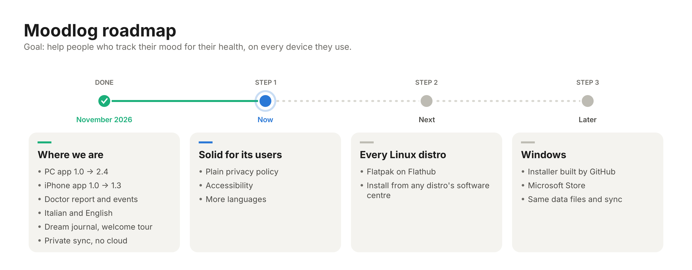

# Moodlog roadmap

**Goal:** help people who track their mood for their health (for example to show a
doctor or therapist how they have been, or how a treatment change went) with an app
that keeps their data private, on every device they use.

The steps are in order: each one builds on the one before. There are no dates; a step
starts when the previous one is done.

## Done (November 2026)

- Moodlog for the PC, 1.0 → 2.4: moods with notes, energy and anxiety, events, charts,
  the doctor report, CSV/XLSX export, backup and restore, two styles.
- Moodlog for iPhone, 1.0 → 1.3: logging on the phone, synced with the PC over home Wi-Fi,
  plus sleep, steps and heart rate from Apple Health.
- English and Italian, a dream journal, and a welcome tour on both.
- No account and no cloud: everything is in plain files on your own devices.

## Step 1 – Solid for its users (now)

- **Privacy policy:** a short, plain one. App stores ask for one, and "your data never
  leaves your devices" is Moodlog's strongest promise.
- **Accessibility:** screen-reader labels and full keyboard use.
- **More languages**, after English and Italian. Writing about how you feel should
  happen in your own language.

## Step 2 – Every Linux distro (next)

- Publish Moodlog as a **Flatpak on Flathub**, so it installs from the software centre
  of any distribution, not only Debian/Ubuntu-based ones.

## Step 3 – Windows (later)

- A Windows installer, built by GitHub for every release, so no Windows PC is needed
  to make it.
- Publish on the **Microsoft Store**.
- Same data files and sync as the other versions, so people can move between devices.

## Not planned

- **Apple's App Store and Mac App Store.** Moodlog for iPhone stays a free download from
  the [releases](https://github.com/Akii-G/moodlog/releases), installed with SideStore
  or AltStore.

---

The timeline image is drawn by `tools/roadmap_image.py`; run it again after changing
the steps.
