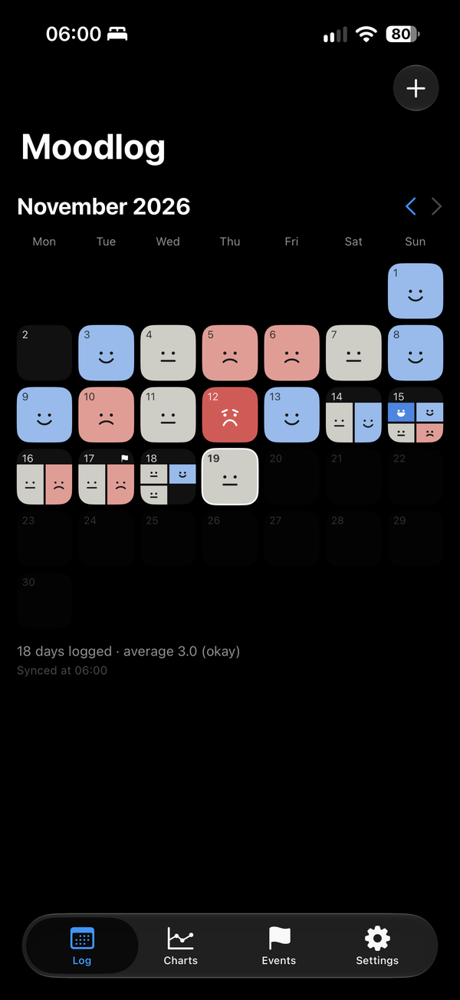

# Moodlog for iPhone

A native SwiftUI companion to Moodlog on the PC: log moods (with energy, anxiety and a
note), see the month calendar and charts, mark events, and sync everything with
Moodlog on your PC over your home Wi-Fi. It can also send Apple Health data (sleep,
steps, resting heart rate) to the PC, replacing the shortcut.

## Install

The app is built by GitHub Actions (`.github/workflows/ios.yml`) on every change to
`ios/`, and attached to every [release](https://github.com/Akii-G/moodlog/releases)
as `Moodlog-iPhone-<version>.ipa`. The iPhone app has its own version number, so check
the release notes (or [CHANGELOG.md](../CHANGELOG.md)) to see whether it changed.
Install the `.ipa` with **SideStore** or **AltStore**.

To try a build that isn't in a release yet, open the repo's **Actions** tab → **iOS app** →
the latest run, and download **Moodlog-iPhone-ipa** under *Artifacts*. GitHub always
delivers artifacts as a `.zip`: extract it to get the `.ipa`, and install that (don't
upload the `.zip` to a release, since every release already gets the `.ipa` automatically).
With a free Apple ID the app must be refreshed every 7 days (SideStore can do this
by itself).

## Connect to your PC

1. On the PC, update Moodlog to 2.5 or newer, open **Phone sync** and switch the
   receiver on.
2. In the app, open **Settings**, enter the address and token shown there (for
   example `http://pop-os.local:8765`), and tap **Test connection**.

Sync runs when the app opens and a few seconds after each change. Entries made away
from home stay on the phone and sync when you are back. For each entry the newest
change wins; deletions sync too.

Everything the app sends is encrypted with your token (AES-256-GCM), and the token
itself never leaves the phone. Moodlog 2.4 and older on the PC can't read it: update
the PC first.

## Build it yourself (needs a Mac)

    brew install xcodegen
    cd ios && xcodegen generate && open Moodlog.xcodeproj
